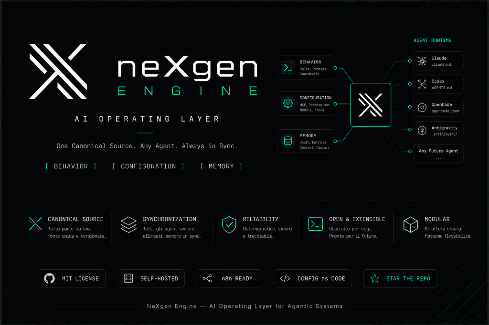
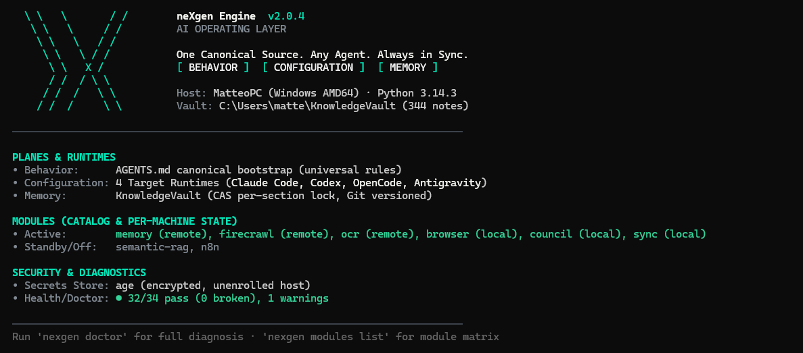

# NeXgen Engine

<p align="center">
  <picture>
    <source srcset="assets/nexgen-architecture-banner.webp" type="image/webp">
    
  </picture>
</p>

<p align="center">
  <a href="https://github.com/matteopasseri407/NeXgen-Engine/actions/workflows/ci.yml"></a>
  <a href="https://github.com/matteopasseri407/NeXgen-Engine/releases/latest"></a>
  <a href="LICENSE"></a>
  
  
</p>

<p align="center">
  <a href="README.md">🇬🇧 English</a> · <a href="#guida-rapida">Guida rapida</a> · <a href="#confronto">Perché NeXgen</a> · <a href="docs/it/architecture-contract.md">Architettura</a> · <a href="CHANGELOG.md">Changelog</a>
</p>

**Fai lavorare come una sola squadra gli abbonamenti AI che paghi già, su tutte le tue macchine.**

NeXgen Engine è un unico repository Git che configura Claude Code, Codex, OpenCode, Antigravity e OpenClaw da una sola sorgente, e li tiene allineati su ogni PC che usi.

## Cosa ottieni

- Ricavi di più dai piani flat. `nexgen quota` legge quello che gli harness su questa macchina hanno già scritto sul proprio consumo: quanto ha consumato ogni piano, la percentuale dove il fornitore la pubblica, il momento del reset quando è noto, e quanto è vecchia la lettura. Una finestra che da qui non si può misurare lo dice, invece di mostrare un numero inventato. Se dichiari una catena di fallback in `quota.yaml`, `nexgen openclaw setup` la scrive negli agenti OpenClaw che il motore crea: quando l'ultima lettura supera la soglia, 95% per default, il turno successivo parte sul modello seguente invece di sbattere contro un piano esaurito. Vedi [quota.md](docs/it/quota.md).

- Modelli di vendor diversi sullo stesso lavoro. `council` convoca come seggi le CLI che hai già, ognuna sul proprio modello, per fare brainstorming, attaccare un piano o rivedere codice scritto da un altro vendor. È opzionale: senza `seats.yaml` il Council non esiste. Vedi [council.md](docs/it/council.md). Un compito supervisionato va oltre: un modello frontier scrive il brief, un esecutore lo porta a termine in una finestra del proprio harness, e il motore tiene i file, il registro dei costi e i gate che girano prima che qualcuno guardi una diff. Quella parte è in anteprima, e la documentazione dice cosa i gate non garantiscono. Vedi [supervision.md](docs/it/supervision.md).

- Connettori e skill configurati una volta sola. Un manifest MCP e un manifest delle skill nel Vault vengono resi nel formato nativo di ogni CLI da `nexgen sync`. L'unione è additiva, quindi un server che hai aggiunto a mano resta. Claude Desktop fa eccezione: riceve solo i connettori che abiliti con `desktop_allow: true`, e solo per i server in sola lettura. Vedi [sync-contract.md](docs/it/sync-contract.md) e [what-gets-written.md](docs/it/what-gets-written.md).

- Più PC da una sola sorgente. `nexgen sync` applica la configurazione su ogni macchina e `nexgen doctor` segnala cosa si è scostato. I segreti stanno in un unico file cifrato con age, con una chiave per ogni macchina registrata, e i token OAuth sono conservati per host, così un token che ruota su un PC non rompe un altro. Vedi [roles.md](docs/it/roles.md).

- Memoria che puoi leggere e confrontare. Il KnowledgeVault è Markdown dentro Git: note, decisioni, stato dei progetti. Le scritture passano dal server MCP del Vault, che controlla prima l'hash della nota o della sezione e rifiuta una sostituzione basata su una versione vecchia. Vedi [architecture-contract.md](docs/it/architecture-contract.md).

- Un solo harness per tutto, se lo vuoi. OpenClaw è l'harness ufficiale del motore: pannello web e app sul telefono sopra gli abbonamenti che paghi già, una squadra di agenti dichiarata in `squad.yaml`, un nodo per PC e binding di canale che portano una chat all'agente giusto. Vedi [openclaw.md](docs/it/openclaw.md) e [squad.md](docs/it/squad.md).

## Demo

```bash
nexgen info    # dashboard: versione del motore, runtime, moduli, server MCP e skill installati, segreti
nexgen doctor  # controlli: allineamento git, raggiungibilità MCP, moduli e skill, segreti e relativi permessi
```

<p align="center">
  <picture>
    <source srcset="assets/nexgen-info-demo.webp" type="image/webp">
    
  </picture>
  <br><em><code>nexgen info</code> su Windows, con host, Vault, runtime, moduli e diagnostica. Per il rapporto completo lancia <code>nexgen doctor</code>.</em>
</p>

## Come funziona

Il motore tiene separate tre cose, ognuna con una sola sorgente nel Vault:

1. Comportamento: regole operative, prompt e guardrail in `AGENTS.md`, collegati in ogni runtime.
2. Configurazione: manifest astratti di MCP e skill, compilati nel formato nativo di ogni CLI da `nexgen sync`.
3. Memoria: il KnowledgeVault in Markdown, versionato in Git, con scritture controllate per hash.

```
                         ┌──────────────┐
                         │  AGENTS.md   │ ──► [ COMPORTAMENTO ]
                         └──────┬───────┘
                                │
   ┌────────────────────────────┼────────────────────────────┐
   │                            ▼                            │
   │                    ┌───────────────┐                    │
   │                    │ neXgen Engine │                    │
   │                    └───────┬───────┘                    │
   │                            │                            │
   ▼                            ▼                            ▼
[ CONFIGURAZIONE ]        [ SEGRETI ]                    [ MEMORIA ]
Manifest MCP / Skill      Archivio age multi-destinatario KnowledgeVault
Claude · Codex ·          Zero passphrase (0600)         Note Git con blocco CAS
OpenCode · Antigravity    Slot OAuth per host            Mappa dei link
```

Ogni file che questi comandi creano è elencato in [what-gets-written.md](docs/it/what-gets-written.md). L'unica scrittura fuori dalla tua home è la policy sudo del ruolo server, descritta in [roles.md](docs/it/roles.md).

## Guida rapida

### Opzione A, installato (consigliata per l'uso quotidiano)

Il pacchetto non è ancora su PyPI, quindi l'installazione parte da questo repository:

```bash
uv tool install git+https://github.com/matteopasseri407/NeXgen-Engine   # oppure: pipx install git+https://github.com/matteopasseri407/NeXgen-Engine
nexgen info
nexgen doctor
```

Un'installazione come pacchetto porta con sé tutto il motore (il Council, il proxy MCP, gli hook, i template) e lascia i launcher al gestore di pacchetti. Non ha una cartella di repository, quindi il Vault arriva dal repository template:

```bash
git clone https://github.com/matteopasseri407/NeXgen-Engine.git ~/KnowledgeVault
nexgen init --local --root ~/KnowledgeVault          # aggiungi --check per guardare prima di scrivere
```

Aggiorna l'installazione con il gestore che l'ha creata. Le release pubblicano un archivio sorgente, una wheel e `SHA256SUMS`; PyPI e Homebrew sono documentati ma non ancora attivi, vedi [release-packages.md](docs/it/release-packages.md).

### Opzione B, clonato (consigliata per lavorare sul motore)

```bash
git clone https://github.com/matteopasseri407/NeXgen-Engine.git ~/KnowledgeVault
cd ~/KnowledgeVault
# Scegli il comando per il ruolo di questa macchina (vedi docs/it/roles.md):
sh install.sh --role server      # gateway Linux headless, sempre acceso
sh install.sh --role node        # nodo che si unisce a un gateway esistente
sh install.sh --role standalone  # PC locale con il proprio gateway
# Windows PowerShell: .\install.ps1 -Role <server|node|standalone>
```

L'installer esegue il bootstrap. Verificalo, poi allinea e controlla ogni volta che cambi qualcosa:

```bash
nexgen sync
nexgen doctor --verbose
```

Su un clone Git, `nexgen update` chiede conferma; il battito pianificato può applicare le patch release senza intervento. Vedi [upgrade.md](docs/it/upgrade.md).

### Configura il tuo ambiente

Apri `INIT.md` e incollalo nella CLI che usi già: Claude Code, Codex, OpenCode o Antigravity. Ti guida nella scelta del profilo e dei moduli.

## Piattaforme supportate

| Sistema | Stato | Su quale evidenza |
|---|---|---|
| Linux | **rilasciato** | la piattaforma su cui viene sviluppato e usato ogni giorno; il ciclo completo (install, allineamento, doctor, grooming, council, update) gira qui e in CI |
| Windows | **rilasciato** | verificato su hardware reale e in CI; esecuzione Python nativa completa, shim dei comandi nativi e allineamento completo delle CLI |
| macOS | **non testato** | condivide i percorsi POSIX con Linux e dovrebbe funzionare, ma nessuno l'ha provato da capo a fondo; considera un guasto qui come previsto, e segnalarlo come utile |

| Assistente | Stato | Cosa è coperto |
|---|---|---|
| Claude Code | **completo** | istruzioni, connettori MCP, skill, guardrail |
| Codex | **completo** | istruzioni, connettori MCP, skill |
| OpenCode | **completo** | istruzioni nei file di scope, connettori MCP, plugin e permessi nativi, skill e un seggio nel Council |
| Antigravity | **completo** | istruzioni, connettori MCP, skill e un seggio nel Council; l'adapter del Council usa agy --print --model ... --disable-slash-commands --new-project --sandbox con il prompt su stdin; i limiti di isolamento del vendor sono in docs/it/council.md |

## Confronto

|  | Una cartella di dotfiles | NeXgen Engine |
|---|---|---|
| Cosa modifichi | i file che ogni CLI legge | un Vault: `AGENTS.md`, il manifest MCP, il manifest delle skill, il file dei segreti |
| Cosa riceve ogni CLI | lo stesso testo, copiato | il proprio formato nativo, generato da `nexgen sync` |
| Scostamenti | te ne accorgi, prima o poi | `nexgen doctor` esce con codice diverso da zero e elenca cosa si è rotto |
| Segreti | nei dotfiles, o a memoria | un file cifrato con age, una chiave per macchina |
| Un secondo PC | un'altra copia da tenere allineata | la stessa sorgente, applicata su ogni macchina |
| Memoria | nessuna | Markdown in Git, con scritture controllate per hash |

Il motore scrive configurazione, legge quello che gli harness lasciano su disco e avvia una CLI quando glielo chiedi. Non si mette fra una CLI e il suo modello. I contratti completi sono in [architecture-contract.md](docs/it/architecture-contract.md) e [sync-contract.md](docs/it/sync-contract.md).

## Domande frequenti

**Posso usarlo per lavoro?**
Il repository usa PolyForm Noncommercial 1.0.0. I termini sono in [LICENSE](LICENSE); se ti serve una licenza commerciale, vedi [COMMERCIAL.md](COMMERCIAL.md).

**Funziona con i server MCP che ho già?**
Sì. La sincronizzazione è additiva: un server presente nella configurazione di una CLI che il manifest non conosce viene conservato e lasciato lì, perché può essere tuo.

**Cosa succede quando doctor non riesce a controllare qualcosa?**
Lo dichiara indeterminato e lo tiene distinto da un guasto. Aggiungi `--strict` se vuoi che anche un controllo non verificabile faccia fallire l'esecuzione.

## Sviluppo

Lo sviluppo avviene su `developer`; le release arrivano su `main` con una pull request verificata. Chi mantiene il progetto pubblica con `nexgen release ship`, che esegue in un solo comando il bump, la pull request, i controlli, il tag firmato e la sincronizzazione. Il [contratto dei rami](docs/it/agent-lanes.md) copre il lavoro in parallelo e il riallineamento automatico con `main`. Proprietari dei moduli e test richiesti sono in [CONTRIBUTING.it.md](CONTRIBUTING.it.md).

## Licenza

PolyForm Noncommercial License 1.0.0. Uso, modifica e installazioni self-hosted liberi per scopi non commerciali. I termini sono in `LICENSE`; per l'uso commerciale vedi `COMMERCIAL.md`.
